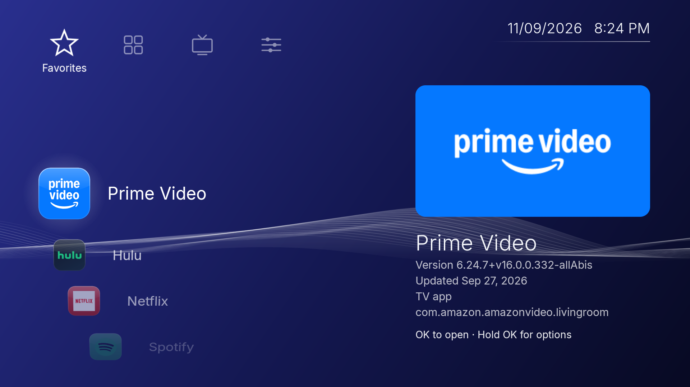
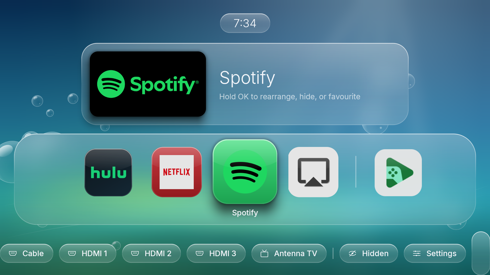
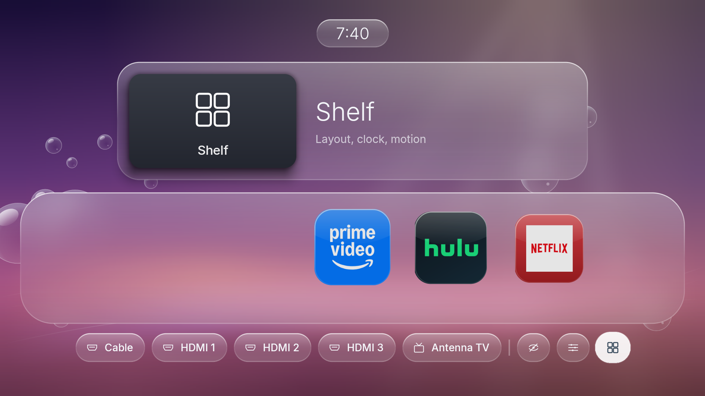
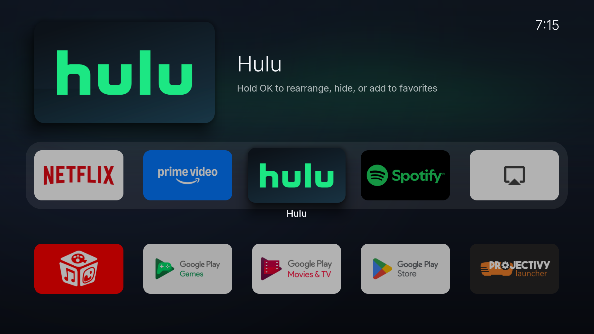

# Shelf

A fast, private home-screen launcher for Android TV, built for low-power TVs (developed on an Android 9 TCL TV).
Pick from three looks, all drawn in code:

| Wave (default) | Aero |
|---|---|
|  |  |
| **Aero Dusk** | **Classic grid** |
|  |  |

## Features

- **Wave**: a category bar top-left (Favorites, Apps, TV, Settings), a scrolling wheel of items, an info panel with
  each app's version and update date, a slowly colour-cycling background with a drifting ribbon of light, soft
  click sounds and an optional ambient music loop (or your own music file).
- **Aero** (Aqua / Dusk / Night): frosted-glass panels, a centred glass clock, a glossy backdrop, a carousel of
  square glossy icons and glass pills for TV inputs and settings.
- **Classic grid**: a large hero banner above a grid of app banners, with a springy focus effect.
- **Rearrange anything**: hold OK to move apps, add them to Favorites, hide them, or open App Info.
- **TV inputs**: switch to HDMI / antenna directly from the home screen.
- **Theme shortcuts**: "Shelf Wave", "Shelf Aero" and "Shelf Grid" appear in your TV's app list.
- **Remembers everything**: order, favourites, hidden apps and theme survive restarts and reboots.
- **Private by design**: no internet permission, no Google Play Services, no analytics or ads.
- **Light on old hardware**: ~42 MB of memory, interactive in ~1.3 s from a cold start on the test TV.

## Requirements

- An Android TV running Android 9 (API 28) or newer, with network ADB enabled
  (Settings → Device Preferences → About → tap *Build* 7×, then Developer options → USB/network debugging).
- To build: JDK 17 and the Android command-line tools (e.g. Homebrew `openjdk@17` + `android-commandlinetools`).

## Quick start

```sh
git clone https://github.com/izaakwhite/shelf-launcher.git
cd shelf-launcher
echo 192.168.1.50:5555 > .tv-address      # your TV's IP and ADB port
adb connect "$(cat .tv-address)"          # accept the prompt on the TV the first time
./deploy.sh                                # builds, installs and launches Shelf
adb shell cmd package set-home-activity app.shelf.launcher/.HomeActivity   # make it the home screen
```

## Design origins

The styles are inspired by familiar TV and console home screens, but every icon, animation, sound and line of code
here is original. No designs, artwork, sounds or code were copied from any other product. See [LEGAL.md](LEGAL.md)
and [docs/design-origins.md](docs/design-origins.md).

## CI/CD

`.github/workflows/ci.yml` runs unit tests and builds on every PR and push. On `main` it also tags the built commit
`v<VERSION>-b<build>` (VERSION comes from `.versions`), publishes a GitHub Release with the APK, and appends a
`build | version | commit | date` line to `.versions` on a separate `versions` branch (`main` is protected: changes go
through a pull request, and only the repo owner can bypass that).

**Signing:** CI builds are signed with a throwaway debug key unless you add these repository secrets, and Android won't
install an update signed with a different key over an older build: `SHELF_KEYSTORE_PATH` (a path you restore from a
secret), `SHELF_KEYSTORE_PASSWORD`, `SHELF_KEY_ALIAS`, `SHELF_KEY_PASSWORD`. Until then, uninstall before sideloading a release.

**Releases:** every merge to `main` is tagged and published as a **pre-release** (`v<version>-b<build>`). To ship a real
version, write commits as `feat: ...` / `fix: ...`; a bot keeps a "Release x.y.z" pull request open (release-please)
that bumps `VERSION` and `CHANGELOG.md`. Merging it creates the `vX.Y.Z` release marked *latest*. (GitHub doesn't run
checks on bot-created PRs, so the owner merges that one with the bypass.)

Tests: `./gradlew :app:testDebugUnitTest` (unit) and `./e2e/run.sh` (drives a real TV; add `--perf` for frame stats).

**Commit hook:** run `./scripts/setup-hooks.sh` once. It then runs Android lint and the unit tests before each commit
(only when code/build files are staged; about a minute). Skip with `git commit --no-verify`.

## License

Apache-2.0 (`LICENSE`). Third-party components are listed in `THIRD_PARTY_NOTICES.md`; the Inter typeface is
under the SIL Open Font License. All artwork, icons, sounds and music are original and generated by code in this
repository.

> Shelf is an independent project. It is not affiliated with or endorsed by Apple, Sony, Google, TCL, or any app
> shown in the screenshots. All trademarks belong to their respective owners.

## Regenerating assets

```sh
python3 tools/gen_sounds.py                     # click sounds + Wave ambient loop → res/raw
java tools/Banner.java app/src/main/res/font/inter_light.ttf app/src/main/res/drawable-xhdpi   # theme banners
```

## Build

Needs Homebrew `openjdk@17` and `android-commandlinetools` (SDK platform 37.0, build-tools 37.0.0).

```sh
source env.sh
./gradlew assembleRelease        # app/build/outputs/apk/release/app-release.apk (R8, debug-signed)
```

## Deploy

```sh
./deploy.sh              # build, push, pm install (90 s limit + hang check), AOT-compile, launch
./deploy.sh --no-build   # reinstall the last build
echo 192.168.1.50:5555 > .tv-address   # your TV's address (git-ignored); or TV=ip:5555 ./deploy.sh
```

`deploy.sh` puts back whatever home app was the default if the install resets it, and won't launch
anything if someone is using another app on the TV.

`tv.sh DPAD_RIGHT DPAD_CENTER …` sends remote keys for testing, but only while Shelf is in the foreground.

## Using it

- **OK** opens · **hold OK** enters edit mode (D-pad moves, OK drops, Back cancels) · **hold OK again** or
  **Menu** opens: Move to/Remove from Favorites, Hide, App Info, Cancel.
- **Back** on the home screen does nothing; **Home** jumps back to the start.
- **Shelf settings** (the grid icon pill in Aero, Settings category in Wave): Style, icon size / grid columns,
  clock, inputs row, sounds, reduce motion, hidden apps.
- **Theme shortcuts**: "Shelf Aero", "Shelf Wave" and "Shelf Grid" appear in the TV's app list (e.g. in Projectivy);
  opening one switches Shelf to that style.
- **Hidden apps**: Shelf settings → Hidden apps (or the eye pill / Settings category); OK unhides.

## Personal sounds (private, never committed)

Shelf can use sound clips **you** supply instead of its built-in clicks and music, on your own TV only. Nothing
is bundled or shipped: the clips live in the git-ignored `private/sounds/` folder and are copied to the TV.

```sh
mkdir -p private/sounds        # put tick.*, ok.*, back.* (and music.*) in here, any audio/video file
./scripts/private-sounds.sh --restart    # converts, trims, pushes, restarts Shelf if it is in front
./scripts/private-sounds.sh --remove     # back to the built-in sounds
```

You are responsible for having the right to use whatever you put there. The project does not include, link to or
fetch any third-party audio.

## Wave music

Wave plays an original ambient loop by default. To use your own music instead:
```sh
adb push my-music.mp3 /sdcard/Android/data/app.shelf.launcher/files/wave_music.mp3
```
(`.ogg`, `.m4a`, `.wav`, `.flac` work too.) It only plays while Wave is on screen, never over another app's audio,
and is **off by default**; turn it on in Shelf settings → Wave music.

## Wallpaper (Aero and Grid styles)

```sh
adb push my-picture.jpg /sdcard/Android/data/app.shelf.launcher/files/wallpaper.jpg
```
`.jpg`, `.png` or `.webp`. It's centre-cropped to 16:9 and blurred once for the glass; press Home to reload.
Delete the file to go back to the generated backdrop.

## Switch back to Projectivy

[Projectivy Launcher](https://github.com/spocky) is the launcher Shelf was built to replace on this TV; its author's GitHub is linked here (the app itself is closed source, the plugins are on GitHub). Shelf is not affiliated with it.

```sh
adb shell cmd package set-home-activity com.spocky.projengmenu/com.spocky.projengmenu.ui.home.MainActivity
```
(or on the remote: Settings → Apps → Default apps → Home app, if TCL's settings show it).

## Uninstall

```sh
adb shell pm uninstall app.shelf.launcher
```
Then set Projectivy as home with the command above if Android asks which home app to use.
